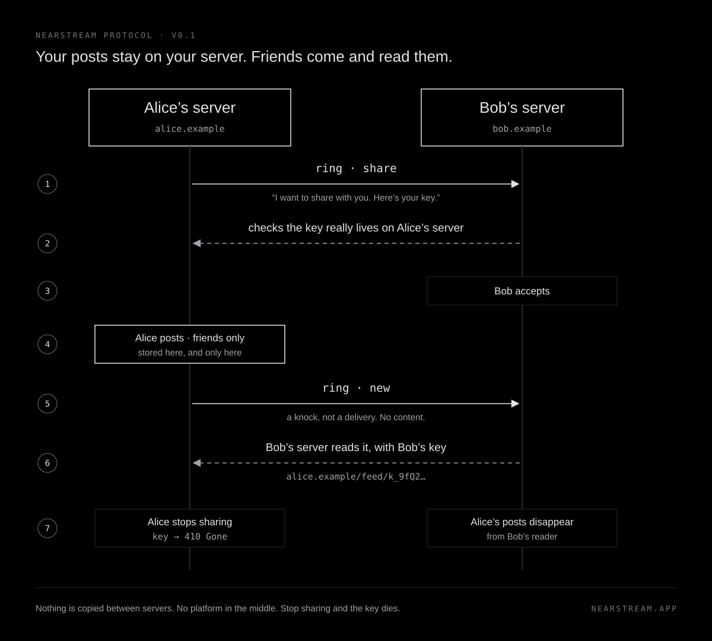

# Nearstream Protocol — v0.1 (draft)

> **Status:** draft, 2026-11-19. Assembled from the design conversations of 2026-11-05 → 2026-11-19; Alessandro owns it. Pairs with [`NEARSTREAM.md`](./NEARSTREAM.md) (why) and [`ARCHITECTURE.md`](./ARCHITECTURE.md) (code shape). This file is the contract: anything that speaks it is Nearstream, whoever wrote it.
>
> Each section is marked **Ships today** (on `main` before the protocol work), **Built** (implemented on the protocol branch and exercised by `npm run lab:test`), or **Proposed** (designed, not built).

---

## 0 — Why this exists

Nearstream scales like email — many small servers, one shared language — not like a platform (NEARSTREAM.md §12). The app alone can't deliver that: an app is one client for one server. A protocol is what lets a friend on someone else's server, or on their own domain, or on a Nearbox, be in the same room as you, with any app they like.

It's email in **shape** — open format, many hosts, any client, you can move — and nothing like email in **experience**: no inbox, no messages piling up, no unread counts, nothing owed. You put things on your own site; the people you've chosen come and look.

## 1 — The rule

**Your content lives only on your home server. Nothing is ever copied to anyone else's.** Friends' servers come and read it; they don't keep it.

What it buys:
- **An instance only hosts its own members.** A post by someone on another server never sits on yours, so you're never the host of strangers. (This is the difference from ActivityPub, which copies every post into every follower's server — the reason every Mastodon admin ends up moderating people they've never met.)
- **Delete means gone.** Delete a post and it disappears from every friend's reader on their next check. Stop sharing with someone and you vanish from their reader.
- **Exit is real.** Your stuff is in one place you control; moving server means moving one folder.

What it costs (accepted):
- **If your server is down, friends can't see anything new from you.** Their reader may still show what it last saw (see §10, reader cache).
- **Your server serves your friends' reads.** At circle scale (~10–80 friends) that's pennies.
- **No global anything.** No public timeline, no search across servers. That's a feature (§9).

## 2 — Words

- **Home server** — the Nearstream server your content lives on. Yours might be `nearstream.app`, your own domain, a friend's instance, or a Nearbox.
- **Address** — how you're identified: your site URL without `https://`. `alessandroborelli.it`, or `nearstream.app/gosia`.
- **Public feed** — your posts anyone may see, as RSS. Any RSS reader in the world can read it.
- **Key** — a private feed URL made for exactly one friend. It shows your public posts plus your friends-only posts.
- **Share** — giving someone a key. One-way: sharing with Gosia doesn't oblige her to share back.
- **Revoke** — killing a key. That one friend stops seeing you; nobody else is affected.
- **Doorbell** — the only door between servers. It rings ("I want to share with you" / "something new"); it never holds content.
- **Friend** — someone whose feed you read (internally: a `Source`). The UI always says *friend* (see NEARSTREAM.md §05).

## 3 — Address

**Built** — `app/[handle]/.well-known/nearstream/route.ts`, `lib/protocol.ts`.

An address is a site URL minus the scheme: `alessandroborelli.it`, `nearstream.app/gosia`. Anything can look it up at:

```
GET https://{address}/.well-known/nearstream
```

which returns:

```json
{
  "protocol": "nearstream/0.1",
  "address": "nearstream.app/gosia",
  "name": "Gosia",
  "mark": "3",
  "feed": "https://nearstream.app/gosia/rss.xml",
  "doorbell": "https://nearstream.app/doorbell/gosia",
  "keys": "https://nearstream.app/feed/"
}
```

| Field | Required | What it's for |
|---|---|---|
| `protocol` | yes | Which version this server speaks (§11). |
| `address` | yes | The canonical address — what the other side stores. |
| `name` | yes | Display name. |
| `mark` | no | Profile-mark variant, as a string index into `PROFILE_MARK_VARIANTS` (`lib/profile-mark-variants.ts`). Readers that don't know the variant fall back to a default. |
| `feed` | yes | The public feed. May 404 if the site is `friends`-only (§5). |
| `doorbell` | yes | Where to ring (§6). |
| `keys` | yes | URL prefix every key this person issues starts with. Used to verify a share is real (§6). |

Rules:
- The document must name the address it was fetched for; a server can't answer for someone else. `feed`, `doorbell` and `keys` must be `https` URLs.
- It answers for every site that isn't `private` — a `friends`-only site has to be findable, or nobody could share with it. It reveals only what a share needs.
- An address can carry a port (`127.0.0.1:3002/bob`). Production speaks `https` only; plain `http` is allowed only when an instance sets `NEARSTREAM_PROTOCOL_ALLOW_HTTP=1`, which the local lab does.
- v0.1 uses the path form, `{address}/.well-known/nearstream`, for addresses with a path (see §10).

## 4 — Public feed

**Ships today** — `app/[handle]/rss.xml/route.ts`.

RSS 2.0 with one extra namespace:

```xml
<rss version="2.0" xmlns:nearstream="https://nearstream.app/ns/v1">
```

Ordinary RSS stays fully valid: every item also carries `<title>`, `<link>`, `<guid>`, `<pubDate>`, `<category>`, an HTML `<description>` (with inline `` / `<audio>` so plain readers can show and play things), and `<enclosure>` for media. The `nearstream:` elements are what let a Nearstream reader render each kind at full fidelity:

| Element | Attributes / content | On |
|---|---|---|
| `nearstream:type` | `note` · `voice` · `essay` · `picture` · `track` | every item |
| `nearstream:audio` | `url` `mime` `durationMs` `viz` (the author's visualizer — it travels with the post) | voice, track |
| `nearstream:track` | `title` `artist?` `durationMs?` | track |
| `nearstream:cover` | `url` (thumbnail if one exists) | track with cover art |
| `nearstream:image` | `url` `width?` `height?` `thumbUrl?` `thumbWidth?` `thumbHeight?` — one per image, in order | picture |
| `nearstream:thumbnail` | `url` `width?` `height?` — the cover, capped at 600px | picture |
| `nearstream:visibility` | `friends` — only ever in key feeds (§5); absent means public | any item |

Rules for readers:
- **Unknown elements and attributes are ignored**, never an error. An unknown `viz` falls back to the default visualizer (already how `normalizeVoiceViz` works).
- **Prefer `nearstream:` over the generic fallbacks** (enclosures, inline HTML) when both exist.

Only `public` posts appear in the public feed; `friends` posts appear only in key feeds (§5); `private` posts never leave the server. The builder for both feeds is `lib/feed-xml.ts`.

## 5 — Keys (friends-only)

**Built** — `app/[handle]/feed/[token]/`, `lib/share-store.ts`, `lib/key-media.ts`. This replaces today's workaround, where `friends`-mode sites 404 their feed to the outside world and same-instance readers get through with a shared secret header (`NEARSTREAM_INTERNAL_SECRET`). That only works inside one instance. Keys work across any two servers.

**Visibility becomes three levels** per post: `public` (public feed + every key), `friends` (every key, never the public feed), `private` (only you).

**A key** is an unguessable token — at least 128 random bits — issued for exactly one (you, friend) pair:

```
https://alessandroborelli.it/feed/k_9fQ2…Xa
```

- It must start with the `keys` prefix in your `.well-known` (§3).
- Its response is the same RSS format as §4, with `public` **and** `friends` posts. Friends-only items add `<nearstream:visibility>friends</nearstream:visibility>` so a reader can mark them.
- **Revoked → `410 Gone`.** A reader that gets 410 drops that friend's posts, the key, and the friend. (`404` is treated as temporary; `410` is final.) A `private` site answers `404` on every key, because the owner can switch back.
- Friends-only items link to the site home and use their id as the guid: their own page 404s for everyone but the owner, so a permalink would be a dead link in the friend's reader.
- Key feeds are sent `cache-control: private, no-store` and `referrer-policy: no-referrer`.

**Media.** Friends-only photos and audio must not leak around the key. The raw media URL (`/api/media/{key}`) is open to anyone who knows it, so a key feed never contains one. Every media URL in a key feed goes through the key:

```
https://alessandroborelli.it/feed/k_9fQ2…Xa/media/{ref}
```

`ref` is an HMAC of the key and the media id under the server secret: it means nothing outside the server and is different for every friend. The server serves the bytes only while the key is alive and only if that media belongs to a post the key can see. Revoke the key and every media URL that friend was ever given dies with it. Public media in the public feed keeps its plain URL.

**Forwarding.** A friend can forward their key, exactly like forwarding an email. The trust model is friendship, not cryptography: you see which key is being used, revoke it, and re-share with the friend.

## 6 — The doorbell

**Built** — `app/[handle]/doorbell/route.ts`, `lib/sharing.ts`. The only server-to-server surface. One URL per address (from `.well-known`). It accepts a small JSON `POST`, always answers `202 Accepted`, and **holds no content**.

### Ring: `share`

```json
{ "ring": "share", "from": "alessandroborelli.it", "key": "https://alessandroborelli.it/feed/k_9fQ2…Xa" }
```

The receiving server verifies before anything reaches a person:
1. Fetch `https://{from}/.well-known/nearstream`.
2. Check `key` starts with that document's `keys` prefix — so the key lives on the sender's own server and can only have come from them.
3. Fetch `key`; it must return a valid feed.

If all three pass, the share becomes a **pending friend** on the receiver's side: *"Alessandro wants to share with you — accept / ignore."* Accept stores the key as a friend's feed. Ignore discards it. Nothing else is kept.

- A second share from the same sender replaces the first; shares don't pile up.
- If you were already reading the sender's public feed, accepting upgrades that friend to the key rather than adding them twice.
- Sharing again with someone who already has a live key re-rings with the same key: one friend, one key.

### Ring: `new`

```json
{ "ring": "new", "from": "alessandroborelli.it" }
```

Carries no content. The receiver re-fetches the key(s) it already holds from `from`. That's all. Because it only ever triggers a fetch of a URL the receiver already trusts, a fake `new` ring can do no harm beyond one wasted request.

Revocation needs no ring of its own: revoke the key, ring `new`, the friend's next fetch gets `410`, they drop you — within seconds instead of at the next poll.

### Abuse and loss
- Bodies over 4 KB, bodies that aren't JSON, and unknown ring types are ignored.
- Rings of the same type from the same `from` more often than once a minute are ignored. (Best-effort: counted per server process.)
- The receiver does its work after answering, so a slow or hostile sender can't hold a connection open.
- A receiver may block an address or a whole domain; rings from it are dropped silently.
- **Rings can be lost.** Polling is the fallback: readers still check keys on a timer (§10 for the interval). The doorbell makes things fast; polling makes them reliable.

## 7 — Client ↔ home server

**Partly built.** The web app's sharing routes exist (`/api/shares`, `/api/shares/{token}/revoke`, `/api/pending-shares/{id}/accept|ignore`, and the share UI on `/reader/friends`). The versioned `/api/v1` for native apps, with token sign-in, is **proposed** and belongs in the app design doc.

An app only ever talks to its own home server. Servers talk to each other (§6). The app needs to:
- sign in (magic link → token)
- post: line, photo, voice note — with `public` / `friends` / `private`
- read: the merged feed of everyone who shares with you
- share with an address, see pending shares, accept / ignore
- see who you share with, revoke a key
- report and block (stores require it; under §1, block hides someone on your side, report goes to their home server)
- delete the account (removes everything; every key returns `410`)

Push notifications ("Gosia posted") go home server → phone via the platform push services. That's between a server and its own app, outside this protocol.

## 8 — The story



Alessandro (`alessandroborelli.it`) and Gosia (`nearstream.app/gosia`):

1. Alessandro types `nearstream.app/gosia` in the app and taps **Share with Gosia**. *(§7)*
2. His server fetches `nearstream.app/gosia/.well-known/nearstream` and finds her doorbell. *(§3)*
3. His server makes a key for her — `alessandroborelli.it/feed/k_9fQ2…Xa` — and rings `share`. *(§5, §6)*
4. Her server verifies: fetches his `.well-known`, checks the key's prefix, fetches the key. *(§6)*
5. Her app shows **"Alessandro wants to share with you."** She accepts; the key is saved as a friend. *(§6, §7)*
6. Alessandro posts a **friends-only** voice note. It's saved on his server only. *(§1, §5)*
7. His server rings `new` on her doorbell. Her server fetches the key, sees the voice note, and her phone shows **"Alessandro posted."** *(§6, §7)*
8. She plays it. The audio streams from his server through a key-scoped media URL. *(§5)*
9. Later, Alessandro revokes Gosia's key and rings `new`. Her server's fetch gets `410 Gone`; his posts disappear from her reader. *(§5, §6)*

If Gosia wants to share back, she runs steps 1–5 the other way.

**Run it.** `npm run lab:test` acts this story out between two real instances on your laptop: Alice and Carol on `localhost:3001`, Bob on `127.0.0.1:3002`. It covers sharing across instances and within one, friends-only and private posts, a forged share, junk rings, and revocation, with 23 checks. `npm run lab` starts the same two instances and leaves them running, so you can do it by hand in two browser windows. Both use in-memory storage only.

## 9 — Not in v0.1

Leaving something out is a decision. These stay out until a real need forces them in — the protocol can grow, it can't easily shrink.

- **Replies, comments, likes, reactions, read receipts.** NEARSTREAM.md §06 still asks when interactions violate "no metrics". Nothing goes in the protocol before that's answered.
- **Messaging / DMs.** Nearstream is not a messenger. No inbox, ever.
- **Discovery, search, directories, suggestions.** You find people the way you get a phone number: they give you their address.
- **Follower counts or lists of who reads you.** You know who you've shared with; nobody sees a number.
- **Copying content between servers.** Ruled out by §1.
- **An ActivityPub bridge.** Maybe later, as a separate thing; never at the cost of §1.

## 10 — Open questions

- **`.well-known` under a path.** RFC 8615 puts `.well-known` at the origin root, so `nearstream.app/gosia/.well-known/nearstream` is non-standard. Alternative: `nearstream.app/.well-known/nearstream?address=nearstream.app/gosia`. Path form is simpler; root form is correct.
- **Key in the URL vs in a header.** URLs leak into logs and referrers. A header is safer but breaks "works in any RSS reader". Maybe both: Nearstream readers send a header, plain readers use the URL.
- **Reader cache.** Readers keep a copy of what they've fetched so the app works offline and loads fast. Is that "copying"? Proposed rule: a cache is allowed, but it must **mirror** the feed — anything absent from the latest fetch, or behind a `410`, is purged. (Today's reader already purges on 404.) Does the feed include all posts, or only recent ones? If only recent, how does a reader tell "deleted" from "too old"?
- **Polling interval.** Today: refresh on open if older than 5 minutes, plus the daily digest. With a doorbell, is hourly background polling enough?
- ~~**Same-instance friends.** Use real keys inside one instance too, or keep a shortcut?~~ **Answered: real keys, one code path.** The lab test shares Alice → Carol on the same instance through the same doorbell. The old shared-secret header is still there for friends added before keys existed; it can go once those have been re-shared.
- **Server-side requests to strangers.** A `share` ring makes the receiver fetch the sender's `.well-known` and key, so anyone can make a server fetch a URL of their choosing. Mitigated (https only, no redirects, 8s timeout, 4 KB rings, work after the response), not solved: a server on a private network should also refuse private IP ranges.
- **Rate limiting across processes.** The doorbell's once-a-minute rule is counted per process; on serverless that's per warm instance. Good enough to blunt a flood; not a guarantee.
- **Mutual shares.** If both sides share, accept automatically, or always ask?
- **Moving server.** Keys are URLs on the old server. Is moving = re-share with everyone, or can the old server answer `301` to the new address for a while?
- **Where media is served from.** Media URLs today use the instance URL, not the site's custom domain. Fine for v0.1?

## 11 — Versioning

- The feed namespace is already versioned: `https://nearstream.app/ns/v1` (ships today).
- `.well-known` declares `"protocol": "nearstream/0.1"`.
- **Must-ignore:** any field, element, attribute or ring type a server doesn't understand is ignored, never an error. That makes additive changes safe within a major version.
- A breaking change bumps the major version (`nearstream/1.0`, `ns/v2`). A server may speak several; it advertises the newest, and both sides fall back to the highest version they share.
